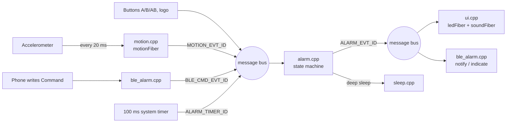
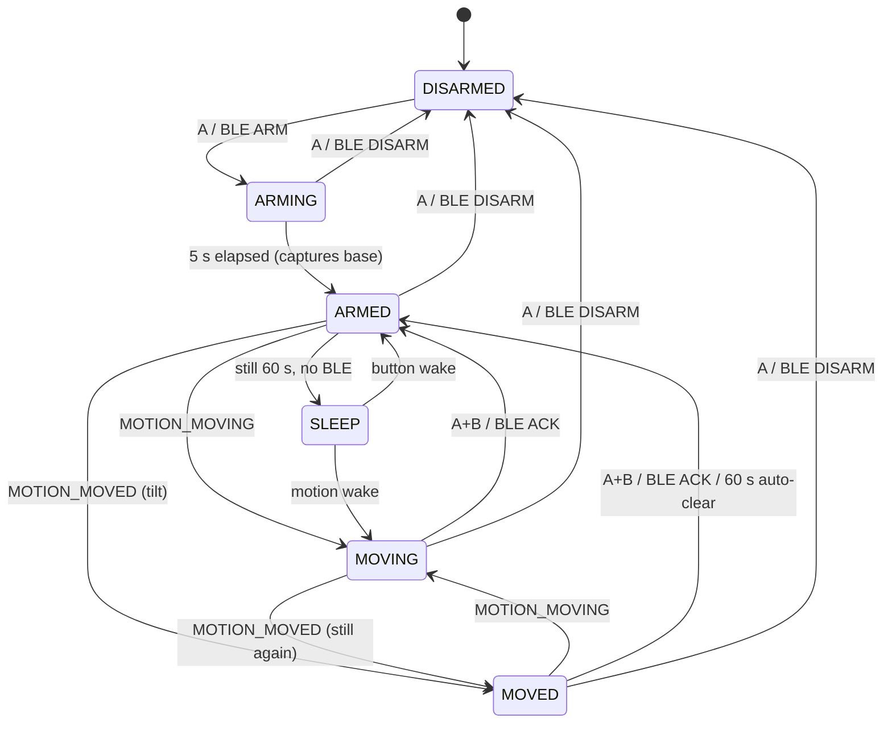

# How the motion alarm code works

This guide walks through the firmware in `source/`. For *what* the alarm should do, see
[`SPEC.md`](SPEC.md). For controls, LED states and pairing, see the top-level `README.md`.

## 1. Big picture

The firmware is a set of small modules that talk only through the CODAL **message bus**.
Nothing calls "up" into another module's logic. Instead, modules raise events and other
modules listen for them.



| File | Role |
| --- | --- |
| `main.cpp` | Starts CODAL, routes audio to the speaker only, initialises the modules, then `release_fiber()` |
| `events.h` | Shared event IDs and enums (`AlarmState`, `SoundMode`, `MotionEventValue`, `BleCommandId`) |
| `alarm.cpp/.h` | The state machine. Owns state, sensitivity, sound mode, mute. Handles all inputs |
| `motion.cpp/.h` | Motion detector: a pure algorithm plus a fiber that samples the accelerometer |
| `ui.cpp/.h` | Two fibers that draw the LEDs and play sounds, based on the current alarm state |
| `ble_alarm.cpp/.h` | Custom GATT service: State, Alarm event and Command characteristics |
| `sleep.cpp/.h` | Sets up the accelerometer wake interrupt, enters deep sleep and finds out what woke the board |

### Start-up order (`main.cpp`)

1. `uBit.init()`. CODAL's BLE pairing mode runs here if A+B is held during reset.
2. `uBit.audio.setPinEnabled(false)` / `setSpeakerEnabled(true)`. Sound goes to the
   on-board speaker only, never to P0.
3. `ui_init()`: starts the LED and sound fibers.
4. `alarm_init()`: loads settings, registers every listener, raises the first
   `ALARM_EVT_ID/DISARMED` and starts the 100 ms tick.
5. `motion_start()`: sets the accelerometer to ±2 g at 50 Hz and starts the sampling fiber.
6. `ble_alarm_init()`: registers the GATT service.
7. `release_fiber()`: `main` never returns. Everything after this runs on fibers and
   event handlers.

## 2. Events (`events.h`)

| ID | Raised by | Value |
| --- | --- | --- |
| `MOTION_EVT_ID` (9000) | `motionFiber` | `MOTION_MOVING`, `MOTION_STILL`, `MOTION_MOVED` |
| `ALARM_EVT_ID` (9001) | `alarm.cpp` | New `AlarmState` (0–5), or `ALARM_EVT_SETTINGS` (0x10) when only a setting changed |
| `BLE_CMD_EVT_ID` (9002) | `ble_alarm.cpp` | `ble_cmd_pack(cmd, arg)` = `arg << 8 \| cmd` |
| `ALARM_TIMER_ID` (9100) | `system_timer_event_every` | `ALARM_TIMER_EVT` every 100 ms |

Custom IDs start at 9000 so they don't clash with CODAL's own component IDs.

Phone commands become bus events instead of being handled straight away. This means BLE
callbacks, which run in SoftDevice context, never touch alarm state directly. All state
changes happen in the alarm's own event handlers.

## 3. The state machine (`alarm.cpp`)

All alarm state is `static` inside `alarm.cpp`. Other modules read it through getters
(`alarm_state()`, `alarm_sensitivity()`, `alarm_sound_mode()`, `alarm_muted()`,
`alarm_countdown_ms()`).



### `setState(next)`

This is the only function that changes `state`. It:

- returns early if the state doesn't change, so listeners never see duplicate events;
- stamps `stateSince` (used by the ARMING countdown);
- clears `muted` and `still` when entering DISARMED, ARMING or ARMED, and clears `still`
  when entering MOVING;
- raises `ALARM_EVT_ID` with the new state.

Settings changes (sensitivity, sound mode, mute) call `raiseSettings()` instead. This raises
`ALARM_EVT_ID/ALARM_EVT_SETTINGS`, so BLE can push a fresh State value without the UI
treating it as a state change.

### Inputs

| Handler | Input |
| --- | --- |
| `handleMotion` | Motion events. MOVING always wins over MOVED. Each repeat event resets `alarmSince`, which restarts the 60 s auto-clear |
| `handleButtonA` | Short: arm/disarm. Long: `motion_capture_base()` (re-reference) in DISARMED/ARMED |
| `handleButtonB` | Short: cycle sensitivity (DISARMED), show it (ARMED), toggle mute (alarm). Long: cycle sound mode |
| `handleButtonAB` | DISARMED: show tilt. Alarm: acknowledge (re-capture base, go to ARMED) |
| `onButtonABDown/Up` | Holding A+B in ARMED shows the live `dyn` bar graph |
| `onLogoClick` | Shows BLE connection status |
| `handleBleCommand` | Same actions as the buttons. The payload was already checked by `ble_cmd_decode` |
| `handleTimer` | Runs every 100 ms. Handles the ARMING timeout, MOVED auto-clear and deciding when to sleep |

Every time the alarm returns to ARMED it first calls `motion_capture_base()`. Whatever
position the board is in now becomes the new "normal" position, so the same tilt does not
retrigger the alarm.

### Persistence

`loadSettings()` reads the `alarm_sens` and `alarm_snd` keys from `uBit.storage` (flash
key/value store) and ignores values that are out of range. `saveSensitivity()` and
`saveSoundMode()` write a key back each time its setting changes.

## 4. Motion detection (`motion.cpp`)

The file has two layers:

- **Pure core**: `motion_reset`, `motion_capture_base`, `motion_update`, `motion_tilt_deg`,
  `motion_thresholds`. These don't touch any hardware, so the host tests can run them
  (`HOST_TEST`).
- **Hardware wrapper**: one `MotionState motionHardwareState`, plus `motionFiber`, which reads
  the accelerometer every 20 ms, calls `motion_update` and raises `MOTION_EVT_ID` whenever it
  returns something other than `MOTION_NONE`.

### Algorithm (`motion_update`, one sample)

All values are in milli-g (mg).

1. **Gravity estimate.** A low-pass filter with α = 0.1:
   `gLp += (a − gLp) · 0.1`. This follows slow orientation changes and averages out
   shaking.
2. **Dynamic acceleration.** `dyn = |a − gLp|`, the part of the reading that isn't
   gravity.
3. **Moving.** If `dyn > moveMg` for 3 samples in a row (`MOTION_SPIKES`), the detector
   enters `moving` and returns `MOTION_MOVING`. Needing 3 samples in a row filters out
   single-sample knocks.
4. **Still timer.** `stillMs` goes up by 20 ms for each sample with `dyn < moveMg / 2`. Any
   sample above that resets it to 0. Using half the threshold here gives hysteresis, so
   the detector doesn't flip between moving and still.
5. After **1 s of stillness**, the detector compares tilt (the angle between `gLp` and
   `base`):
   - if it was `moving`, it returns `MOTION_MOVED`. A moving episode always ends in MOVED.
   - on the first still period after a reset or capture, it returns `MOTION_MOVED` if
     `tilt > tiltDeg` and `MOTION_STILL` otherwise.
   - while still, it returns `MOTION_MOVED` once when tilt goes over `tiltDeg`
     (`tiltAlarmed` latch). The latch resets when tilt drops below `tiltDeg / 2`.

`MOTION_STILL` only matters in ARMED. It starts the countdown to deep sleep.

### Thresholds

| Level | `moveMg` | `tiltDeg` |
| --- | --- | --- |
| 1 (low) | 250 | 25 |
| 2 (medium, default) | 120 | 15 |
| 3 (high) | 60 | 8 |

`motion_thresholds(level)` clamps `level` to 1–3. `sleep.cpp` also uses these numbers for the
wake threshold.

### Base capture

`base` is the "normal" orientation. `motion_capture_base()` copies the current `gLp` into it
and clears all latches. It is called when ARMING finishes, on acknowledge, on auto-clear,
and on a long press of A.

## 5. UI (`ui.cpp`)

The UI is not driven by events. Two fibers poll `alarm_state()` and draw whatever matches it:

- **`ledFiber`** (every 20–100 ms): picks the image for the current state (see the LED
  table in `README.md`). It uses `system_timer_current_time()` for animation timing, so the
  heartbeat, arrows and blinking `!` need no extra state.
- **`soundFiber`**: ticks once per second during ARMING. In ALARM_MOVING it plays the siren
  (880/660 Hz) or beeps (1 kHz), depending on the sound mode. It is silent in every other
  state, including ALARM_MOVED. Tones are a square wave on `uBit.audio.virtualOutputPin`.
  `sleepWhile()` re-checks `soundActive()` every 50 ms, so mute, acknowledge or a state
  change stops the sound within 50 ms.

**Overlays** are short messages shown on top of the state display: check mark, sensitivity
bars, sound mode letter, BLE status, tilt scroll and the live `dyn` graph. `ui_show_*()`
only sets `overlay`, `overlayArg` and `overlayUntil`. `ledFiber` draws the overlay until it
expires. `onAlarmEvent` cancels any overlay when the state changes, so an alarm is never
hidden behind a menu message.

### Deep-sleep handshake

`ui_prepare_sleep()` waits up to 500 ms for both fibers to report idle (`audioIdle`,
`ledIdle`, which they set when they see `ALARM_SLEEP`). It then sets `uiLocked` so neither
fiber touches the display or speaker while the power manager has them switched off.
`ui_end_sleep()` clears the lock after wake-up.

## 6. Deep sleep (`alarm.cpp` → `sleep.cpp`)

`handleTimer` puts the board to sleep only when **all** of these are true:

- state is ARMED and the detector reported `MOTION_STILL`, at least 60 s ago;
- no BLE link, and the last disconnect was ≥ 60 s ago;
- the detector is not currently `moving`, and tilt is within the threshold (so the board
  doesn't fall asleep while a motion event is still waiting in the queue);
- no overlay is showing.

Then:

1. `setState(ALARM_SLEEP)`. The UI fibers go idle.
2. `ui_prepare_sleep()`. If it fails, or a phone connected in the meantime, the board goes
   back to ARMED and tries again about 1 s later.
3. `sleep_enter(sensitivity)`:
   - saves the LSM303AGR registers it is about to change;
   - sets up INT1 with a high-pass filter (removes gravity) and an OR of X/Y/Z high
     events. The threshold is `ceil(moveMg / 16)` because one LSB is 16 mg at ±2 g;
   - enables wake on buttons A and B;
   - calls `uBit.accelerometer.removeComponent()` so CODAL doesn't turn the sensor off;
   - stops BLE advertising, then calls `uBit.power.deepSleep()`, which blocks until wake-up.
4. `sleep_exit()` reads `INT1_SRC` and the button states, restores the saved registers and
   returns the wake cause.
5. Back in `handleTimer`: `motion_reset_after_wake()`, `ui_end_sleep()`, start advertising
   again, then:
   - **button wake** → ARMED. CODAL has already queued the button press, so it is then
     handled as a normal ARMED press;
   - **motion wake** → `motion_mark_moving()` + ALARM_MOVING. The detector then reports MOVED
     once the board is still again;
   - **unknown** → ARMED.

All of this runs inside the timer event handler, so it executes on an event fiber and may
block.

## 7. BLE (`ble_alarm.cpp`)

Like `motion.cpp`, it is split into a pure part and a hardware part:

- **Codec** (host-tested): `ble_state_encode`, `ble_alarm_encode`, `ble_cmd_decode`.
  `ble_cmd_decode` rejects payloads that aren't exactly 2 bytes, unknown commands, and
  arguments out of range.
- **`MotionAlarmService`** (`MicroBitBLEService` subclass), base UUID
  `c95a0000-36d7-4d56-bfbc-f6b93aab3e5e`:

| UUID suffix | Characteristic | Properties | Payload |
| --- | --- | --- | --- |
| `0002` | State | read, notify | `state, sensitivity, sound_mode, muted` |
| `0003` | Alarm event | read, indicate | `type, seq_lo, seq_hi, tilt` |
| `0004` | Command | write | `cmd, arg` |

Flow:

- **Phone → board:** `onDataWritten` → `ble_cmd_decode` → raises `BLE_CMD_EVT_ID` →
  `alarm.cpp` handles it.
- **Board → phone:** `alarmEventListener` receives every `ALARM_EVT_ID`. It always updates
  and notifies State. On a state change it sends an Alarm event indication: MOVING (1) and
  MOVED (2) on entry, and CLEARED (3) when leaving MOVING or MOVED for any other state.
  `seq` goes up by one with each indication, so the phone can spot ones it missed.
- `onConnect` / `onDisconnect` record the link state and disconnect time that the sleep
  logic uses.

The whole service is compiled only when `DEVICE_BLE` and `MICROBIT_BLE_ENABLED` are set in
`codal.json`. Otherwise stubs report "never connected", so sleep is never blocked by BLE.

## 8. Host tests (`tests/`)

`tests/CMakeLists.txt` builds `motion.cpp` and `ble_alarm.cpp` for the host with `HOST_TEST`
defined. This removes all CODAL code and keeps only the pure functions.

```bash
cmake -S tests -B build/tests && cmake --build build/tests && ctest --test-dir build/tests
```

- `test_motion.cpp` feeds synthetic accelerometer samples into `motion_update` and checks
  the events that come out.
- `test_ble.cpp` checks the payload encoders and the command validation.

## 9. Common changes

| Goal | Where |
| --- | --- |
| Change detection thresholds | `motionThresholds[]` in `motion.cpp` (the sleep wake threshold follows automatically) |
| Change arming/auto-clear/sleep timing | `ARMING_MS`, `AUTO_CLEAR_MS`, `SLEEP_STILL_MS`, `SLEEP_BLE_GRACE_MS` in `alarm.cpp` |
| Add a button action | A `handleButton*` function in `alarm.cpp`. Register any new listener in `alarm_init()` |
| Add a BLE command | Add an enum value in `events.h`, validate it in `ble_cmd_decode`, handle it in `handleBleCommand`, and add a test in `test_ble.cpp` |
| Add a state | Add it to `AlarmState`, then handle it in `setState`, `ledFiber`, `soundFiber` and `handleAlarmEvent` (BLE) |
| Change sounds/images | `soundFiber` helpers and the `MicroBitImage` constants in `ui.cpp` |

Rules to keep in mind (see `AGENTS.md`): handlers must not busy-wait (use `uBit.sleep`),
long loops must yield, and BLE vs radio is chosen in `codal.json`, never with a `#define`
in source.
